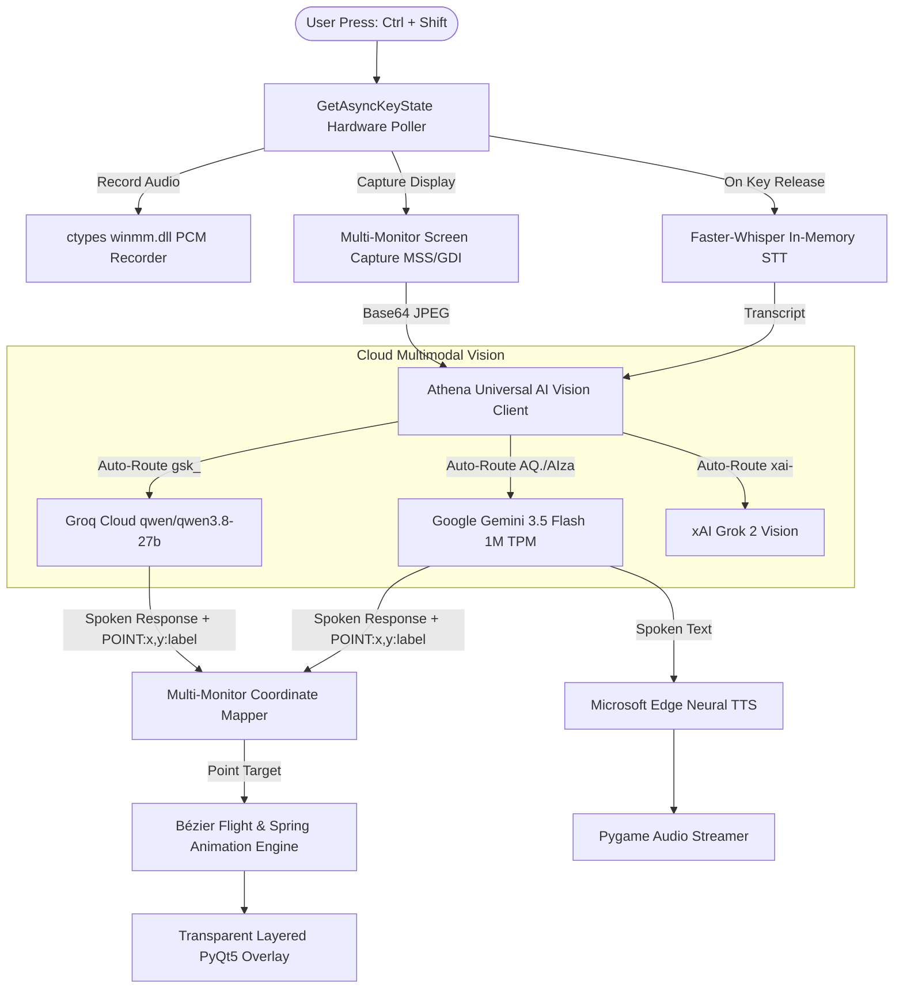

# 🦉 Athena Everyday Desktop Companion

[](https://microsoft.com/windows)
[](https://python.org)
[](https://riverbankcomputing.com/software/pyqt/)
[](https://aistudio.google.com/)
[](https://github.com/SYSTRAN/faster-whisper)
[](https://github.com/rany2/edge-tts)

**Athena** is an always-on, perceptive AI desktop companion for Windows, reverse-engineered and built from the ground up to bring the elegance and capabilities of macOS companion apps (such as HeyClicky) to Windows with **zero subscription fees**.

Athena lives transparently on your screen, follows your cursor with fluid spring physics, captures your screen context when spoken to, points precisely at UI elements using quadratic Bézier flight swoops, and speaks back conversationally with natural neural voices.

---

## ✨ Key Capabilities

* **Push-to-Talk Screen Awareness**: Hold `Ctrl + Shift` anywhere in Windows to speak. Athena records your microphone, grabs multi-monitor screenshots, transcribes speech locally, and answers in under 1.5 seconds.
* **Autonomous Element Pointing**: When asked how to do something, find a button, or navigate an app, Athena’s glowing blue triangle cursor detaches, performs a smooth quadratic Bézier flight animation, and points directly at the relevant element with an anchor label.
* **Dual-Display & Multi-Monitor Support**: Native coordinate mapping across multi-monitor setups, including secondary displays positioned with negative virtual coordinates (`DISPLAY1` at `-1920, -71`).
* **100% Free Multimodal Vision**:
  * **Google Gemini 3.5 Flash**: 1,000,000 Tokens/Minute (TPM) and 1,500 requests/day free tier with state-of-the-art visual element grounding.
  * **Groq Cloud (`qwen/qwen3.8-27b`)**: Ultra-fast open vision model.
  * **xAI Grok 2 Vision (`grok-2-vision-1212`)**: Optional paid xAI endpoint.
* **Zero-Latency In-Memory Audio Pipeline**:
  * **Capture**: Pure ctypes `winmm.dll` PCM capture bypassing PyAudio driver overhead.
  * **STT**: `faster-whisper` processing raw 16kHz float32 NumPy arrays in RAM (bypassing PyAV container decode).
  * **TTS**: Microsoft Edge Neural TTS (`en-US-JennyNeural`, `en-GB-SoniaNeural`, `en-US-GuyNeural`) streamed in real-time.
* **Transparent Click-Through Overlay**: Fullscreen Win32 layered window (`WS_EX_LAYERED | WS_EX_TRANSPARENT`) running at 60 FPS without intercepting mouse clicks intended for underlying applications.

---

## 🏗️ Architecture Overview



---

## 🚀 Quickstart

### 1. Installation
Clone this repository and install Python dependencies:

```powershell
git clone https://github.com/Charukhesh/Athena-Everyday-Agent.git
cd Athena-Everyday-Agent
pip install -r requirements.txt
```

### 2. Configure Your Vision API Key
Athena supports free API keys from **Google AI Studio** or **Groq Cloud**:

1. Get a free Google Gemini key from [aistudio.google.com/app/apikey](https://aistudio.google.com/app/apikey).
2. Launch Athena:
   ```powershell
   python run_athena.py
   ```
3. Click the glowing blue triangle tray icon in your Windows notification area (bottom right).
4. Paste your key (starts with `AQ.` or `AIza...`), click **"Test"** (turns green to indicate `Connected!`), and click **"Save"**.

### 3. Usage & Hotkeys
* **Hold `Ctrl + Shift`**: The triangle cursor pulses red and displays a live audio waveform. Speak your question or request.
* **Release `Ctrl + Shift`**: Athena captures the active display, shows a spinning ring while reasoning, and speaks the answer. If an element is referenced, Athena flies to and points at the element on screen!
* **System Tray Icon**: Click the blue triangle in the taskbar notification tray to open the control panel, adjust voices, or run the interactive pointing demo.

---

## ⚙️ Configuration (`~/.athena/config.json`)

Settings are saved in your user home directory at `~/.athena/config.json`:

```json
{
  "api_key": "YOUR_GEMINI_OR_GROQ_API_KEY_HERE",
  "model": "auto",
  "hotkey": "ctrl+shift",
  "tts_voice": "en-US-JennyNeural",
  "tts_rate": "+0%",
  "transient_mode": false,
  "whisper_model": "base.en",
  "cursor_color": "#3380FF",
  "conversation_history_limit": 10,
  "system_prompt_rules": true
}
```

---

## 📦 Building Standalone Executable (`athena.exe`)

To compile Athena into a standalone Windows `.exe`:

```powershell
python build_exe.py
```

The resulting application is generated at `dist/athena/athena.exe`.

---

## 📄 License
MIT License. Created by Charukhesh.

