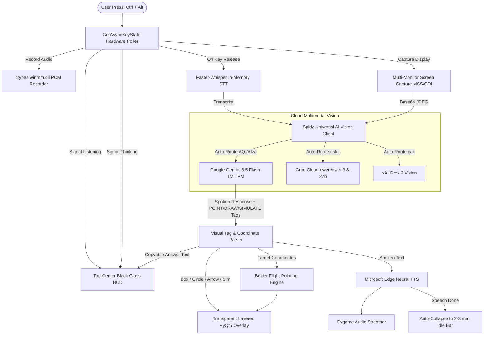

# 🦉 Spidy Everyday Desktop Companion

[](https://microsoft.com/windows)
[](https://python.org)
[](https://riverbankcomputing.com/software/pyqt/)
[](https://aistudio.google.com/)
[](https://github.com/SYSTRAN/faster-whisper)
[](https://github.com/rany2/edge-tts)

**Spidy** is an always-on, perceptive AI desktop companion for Windows, reverse-engineered and built from the ground up to bring the elegance and capabilities of macOS companion apps (such as HeyClicky) to Windows with **zero subscription fees**.

Spidy lives transparently on your screen, follows your cursor with fluid spring physics, captures your screen context when spoken to, points precisely at UI elements using quadratic Bézier flight swoops, draws visual bounding boxes and workflow simulations, and speaks back conversationally with natural neural voices.

---

## ✨ Key Capabilities

* **Unified Push-to-Talk Hotkey (`Ctrl + Alt`)**: One simple, ergonomic hotkey for everything. Hold `Ctrl + Alt` anywhere in Windows to speak. Spidy records your microphone, grabs multi-monitor screenshots, transcribes speech locally in memory, and answers with ultra-low latency.
* **Top-Center Black Glass Dynamic Bar HUD**:
  * **Idle State**: A discrete, ultra-thin 2-3 mm (~10px) obsidian black glass hairline bar pinned to the top-center of your primary display.
  * **Interactive Transitions**: Expands fluidly into an animated `Listening...` / `Thinking...` pill during interaction.
  * **Rich Text Output & 1-Click Copy**: Displays the formatted answer text with full mouse text selection and a 1-click **"Copy Answer"** button.
  * **Auto-Collapse**: Smoothly disappears back into the original 2-3 mm thin bar once the response is finished, never cluttering your workspace. Clicking or hovering the thin bar re-opens the latest answer anytime.
* **On-Screen Visual Drawing & Highlighting**:
  * **Bounding Boxes**: Glowing neon-blue translucent boxes around buttons, code regions, or error dialogs with label badges.
  * **Focal Circles**: Pulsing highlight rings around icons, tools, or elements.
  * **Directional Arrows**: Sleek glowing guide arrows pointing directly towards UI targets.
  * **Workflow Simulations**: Step-by-step numbered visual paths (`①`, `②`, `③`) connected by dashed guide curves when demonstrating how to complete tasks.
  * **On-Screen Notes**: Floating glass annotation cards anchored directly next to UI elements.
* **Sub-Pixel Pointing Accuracy**: Re-engineered using normalized 0..1000 coordinate mapping with display geometry scaling, achieving ~1.0px accuracy across single and multi-monitor setups.
* **Deep Context Awareness**: Spidy automatically inspects the active foreground application (e.g. `Visual Studio Code`, `Chrome`), active window/document title, and currently highlighted/selected text, feeding it to Gemini for situational precision.
* **Interactive Modern Audio Cues**: Pleasant zero-latency audio chimes on hotkey activation, thinking swell, and target pointing arrival.
* **100% Free Multimodal Vision**:
  * **Google Gemini 3.5 Flash / Flash-Lite**: 1,000,000 Tokens/Minute (TPM) and 1,500 requests/day free tier with state-of-the-art visual element grounding.
  * **Groq Cloud (`qwen/qwen3.8-27b`)**: Ultra-fast open vision model.
  * **xAI Grok 2 Vision (`grok-2-vision-1212`)**: Optional paid xAI endpoint.
* **Transparent Click-Through Overlay**: Fullscreen Win32 layered window (`WS_EX_LAYERED | WS_EX_TRANSPARENT | WS_EX_NOACTIVATE`) running at 60 FPS without intercepting mouse clicks intended for underlying applications.

---

## 🏗️ Architecture Overview



---

## 🚀 Quickstart

### 1. Installation
Clone this repository and install Python dependencies:

```powershell
git clone https://github.com/Charukhesh/spidy.git
cd spidy
pip install -r requirements.txt
```

### 2. Configure Your Vision API Key
Spidy supports free API keys from **Google AI Studio** or **Groq Cloud**:

1. Get a free Google Gemini key from [aistudio.google.com/app/apikey](https://aistudio.google.com/app/apikey).
2. Launch Spidy:
   ```powershell
   python run_spidy.py
   ```
3. Click the glowing blue triangle tray icon in your Windows notification area (bottom right).
4. Paste your key (starts with `AQ.` or `AIza...`), click **"Test"** (turns green to indicate `Connected!`), and click **"Save"**.

### 3. Usage & Hotkeys
* **Hold `Ctrl + Alt`**: The top-center bar smoothly expands to `Listening...` with a blue audio pulse. Speak your question or request.
* **Release `Ctrl + Alt`**: The bar shows `Thinking...`. Spidy captures your screens, reasons over your question, displays the copyable text in the top bar, draws any requested visual guides (boxes, circles, arrows, simulations), and speaks the answer.
* **Auto-Collapse**: As soon as speech finishes, the top bar smoothly collapses into the thin 2-3 mm black glass bar.
* **1-Click Copy**: Click **"Copy Answer"** or click the collapsed bar anytime to view and copy previous responses.

---

## ⚙️ Configuration (`~/.spidy/config.json`)

Settings are saved in your user home directory at `~/.spidy/config.json`:

```json
{
  "api_key": "YOUR_GEMINI_OR_GROQ_API_KEY_HERE",
  "model": "auto",
  "hotkey": "ctrl+alt",
  "tts_voice": "en-US-JennyNeural",
  "tts_rate": "+0%",
  "top_bar_hud_enabled": true,
  "transient_mode": false,
  "whisper_model": "base.en",
  "cursor_color": "#3380FF",
  "conversation_history_limit": 10
}
```

---

## 📦 Standalone Executable (`spidy.exe`)

Spidy compiles into a completely standalone Windows executable with all neural models and audio drivers bundled:

```powershell
python build_exe.py
```

The resulting standalone executable is automatically deployed to:
`C:\Users\<user>\Downloads\spidy.exe`.

---

## 📄 License
MIT License. Created by Charukhesh.
